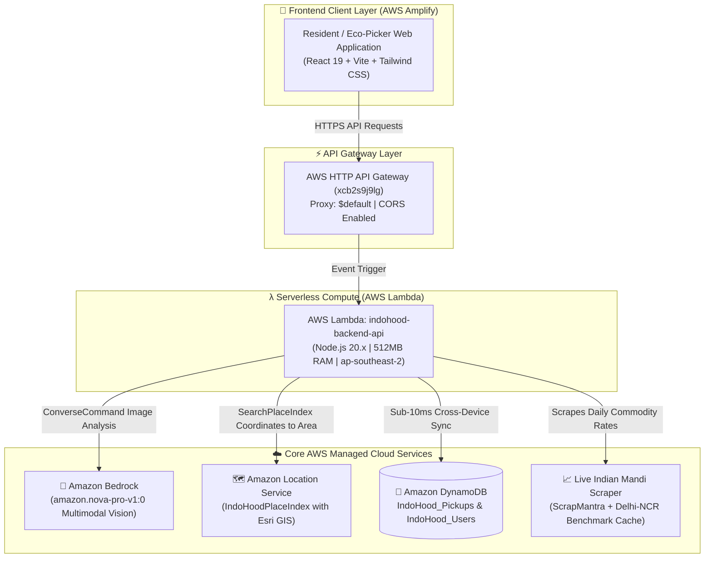

# IndoHood 

> **"One more use. One less ending."**  
> *AI-Powered Household Waste Segregation, Circular Recycling & Green Rewards Ecosystem.*

[](https://aws.amazon.com/bedrock/)
[](https://aws.amazon.com/lambda/)
[](https://aws.amazon.com/dynamodb/)
[](https://aws.amazon.com/location/)
[](https://aws.amazon.com/amplify/)
[](https://www.wemakedevs.org/aws/env)

---

## 🌐 Live Production Deployments

| Component | AWS Cloud Service | Live URL / Endpoint | Status |
| :--- | :--- | :--- | :--- |
| **Frontend Web App** | **AWS Amplify Hosting** | [https://main.d2amzlu3gcfulj.amplifyapp.com/](https://main.d2amzlu3gcfulj.amplifyapp.com/) | 🟢 **LIVE & SUCCEEDED** |
| **Backend REST API** | **AWS HTTP API Gateway** | [https://xcb2s9j9lg.execute-api.ap-southeast-2.amazonaws.com](https://xcb2s9j9lg.execute-api.ap-southeast-2.amazonaws.com) | 🟢 **LIVE & HEALTHY** |
| **Serverless Compute** | **AWS Lambda (`indohood-backend-api`)** | Node.js 20.x, 512MB RAM, Sydney (`ap-southeast-2`) | 🟢 **ACTIVE** |
| **AI Vision Engine** | **Amazon Bedrock** | `amazon.nova-pro-v1:0` & `amazon.nova-lite-v1:0` | 🟢 **ACTIVE** |
| **Cloud Database** | **Amazon DynamoDB** | `IndoHood_Pickups` & `IndoHood_Users` (Sydney) | 🟢 **ACTIVE** |
| **Geospatial Engine** | **Amazon Location Service** | `IndoHoodPlaceIndex` (Esri Geocoding) | 🟢 **ACTIVE** |

---

## 💡 The Core Problem & Our Solution

Over **70% of urban Indian household waste** ends up in landfills not because it cannot be recycled, but because it arrives mixed. Households lack instant clarity on which bin an item belongs to, and there is zero direct economic incentive or transparent pricing for segregated scrap.

**IndoHood changes the way things move in 3 steps:**
1. 📸 **1-Second AI Camera Scan**: Point your phone camera at any waste item — **Amazon Bedrock Nova Pro** multimodal vision classifies it into **Degradable (Green Bin)**, **Non-Degradable (Blue Bin)**, or **Mix/Hazardous (Red/Black Bin)** under India's *Solid Waste Management Rules, 2016*.
2. ⚖️ **Live Indian Mandi Scrap Valuation**: An automated scraping engine benchmarks daily wholesale scrap commodity prices (Iron ₹32/kg, Newspaper ₹16/kg, PET Plastic ₹22/kg, Copper ₹550/kg) to provide accurate estimated value.
3. 🚚 **Doorstep Pickups, EcoCredits & Local Ranking**: Residents schedule handovers with local *kabadiwalas*, earn **EcoCredits**, climb **hyperlocal neighborhood leaderboards**, and receive official **Green Citizenship Certificates**.

---

## 🏛️ Production AWS Cloud Architecture



---

## ☁️ AWS Services Implemented

1. **Amazon Bedrock (`amazon.nova-pro-v1:0` & `nova-lite-v1:0`)**:
   - Executes multimodal visual reasoning on camera-captured waste images.
   - Outputs strict structured JSON: material composition, statutory bin classification, estimated weight in grams, and actionable disposal tips without GPU server maintenance.
2. **AWS Lambda (`indohood-backend-api`)**:
   - Serverless microservice compute wrapped with `serverless-http`.
   - Automatically scales from 0 to peak concurrency with **\$0 idle cost** when no requests are active.
3. **AWS HTTP API Gateway (`xcb2s9j9lg`)**:
   - Ultra-low latency API gateway proxying requests to Lambda with automated CORS management.
4. **Amazon DynamoDB (`IndoHood_Pickups`, `IndoHood_Users`)**:
   - Fully managed NoSQL key-value and document database delivering sub-10ms single-digit read/write latency.
   - Synchronizes pickup schedules, activity logs, and resident profiles across multiple devices.
5. **Amazon Location Service (`IndoHoodPlaceIndex`)**:
   - Enterprise geospatial reverse geocoding powered by **Esri** GIS data.
   - Converts browser GPS coordinates `(lat, lng)` into Indian municipal localities, colonies, and postal areas for hyperlocal community rankings.
6. **AWS Amplify Hosting**:
   - Continuous deployment (CI/CD) connected to GitHub `main` branch.
   - Automates Vite production builds, asset compression, and global edge CDN hosting.
7. **AWS IAM (`IndoHoodBackendLambdaRole`)**:
   - Enforces least-privilege security roles granting Lambda scoped permissions to Bedrock, DynamoDB, and Location Service with zero hardcoded credentials.

---

## 🔮 Future Roadmap & Hardware Vision

### 01. IndoHood Smart Bin & The Circular Loop
* **Hardware Vision**:
  - The resident deposits mixed household waste directly into the IndoHood Smart Bin.
  - Internal AI vision cameras and optical sensors identify and automatically sort materials into internal **Dry**, **Wet**, and **E-Waste/Hazardous** compartments.
  - Once sorted, the Smart Bin screen displays a **dynamic QR Code**.
  - The resident scans the QR Code using their phone to instantly claim their **EcoCredits**.
  - Residents can then exchange those EcoCredits for **real products manufactured directly from their recycled waste** (recycled stationery, seed pens, upcycled planter pots, and circular tote bags).
* *Note: Hardware is a future step.*

### 02. Route Optimization
* Automatically group nearby doorstep pickup requests into shorter, more efficient travel routes for pickers using Amazon Location Service routing, cutting transit time and fuel consumption.

### 03. Hyperlocal Postal Rankings
* Expand leaderboard clustering by municipal postal code and ward boundaries to keep civic leaderboards relevant, competitive, and fair within local apartment societies and RWAs.

---

## ♻️ 3-Stream Municipal Waste Segregation

| Stream | Bin Color | Common Household Scrap | Destination & Processing | EcoCredits Reward |
| :--- | :--- | :--- | :--- | :--- |
| 🟢 **Degradable** | **Green Bin** | Kitchen vegetable/fruit peels, leftover food, tea leaves, unlaminated cardboard | Aerobic composting / organic soil manure | **+10 to +15 Credits** |
| 🔵 **Non-Degradable** | **Blue Bin** | PET plastic bottles, milk pouches, aluminium cans, copper wiring, e-waste, chargers | Authorized scrap aggregators & circular recycling | **+15 to +30 Credits** |
| 🔴 **Mix / Hazardous** | **Red/Black Bin** | Expired medicine strips, blister packs, sanitary refuse, biohazard soiled items | Municipal high-temperature incineration | **+5 Credits** |

---

## 🚀 Local Development Setup

### Prerequisites
- Node.js `v20+`
- AWS Account configured with Bedrock & DynamoDB access in `ap-southeast-2`

### Quick Start
```bash
# 1. Clone repository
git clone https://github.com/aakashshakya0001-png/Indohood.git
cd Indohood

# 2. Install dependencies
npm run install:all

# 3. Start Frontend (Vite server on port 5173)
npm run dev:frontend

# 4. Start Backend (Express API on port 5000)
npm run dev:backend
```

---

## 👥 Submission Details
* **Project**: IndoHood
* **GitHub Repository**: [https://github.com/aakashshakya0001-png/Indohood](https://github.com/aakashshakya0001-png/Indohood)
* **Live Web App**: [https://main.d2amzlu3gcfulj.amplifyapp.com/](https://main.d2amzlu3gcfulj.amplifyapp.com/)
* **Built For**: Environmental Hacks — Bharat Builds Tour by WeMakeDevs & AWS
